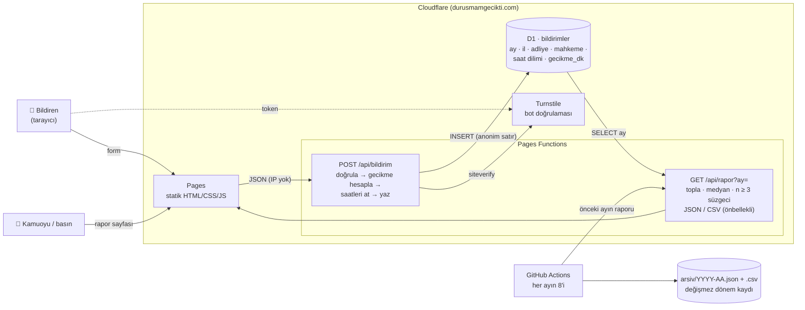

# Duruşmam Gecikti

Cumhuriyet Avukatları sivil toplum inisiyatifi: avukatların ve vatandaşların duruşma
gecikmelerini **anonim** olarak bildirdiği, verilerin **aylık** olarak mahkeme bazında
otomatik raporlandığı basit bir web uygulaması.

- **Bildir** (`/`) — 1 dakikalık form, kişisel veri istemez.
- **Raporlar** (`/rapor.html`) — ay seçimi, özet kutucuklar, mahkeme tablosu, il / tür / saat
  grafikleri, CSV indirme ve “Yazdır / PDF”.
- **Yöntem & Gizlilik** (`/hakkinda.html`) — kamuya açık metodoloji ve aydınlatma notu.

Altyapı tamamen Cloudflare ücretsiz katmanında çalışır: **Pages** (statik site) +
**Pages Functions** (3 küçük API) + **D1** (SQLite veritabanı) + **Turnstile** (bot koruması).
Derleme adımı, framework veya harici CDN yoktur.

## Mimari



**Veri akışı.** Form tarayıcıda gecikmeyi önizler; sunucu (Pages Function) her alanı sabit
listelere karşı doğrular, gecikmeyi kendisi hesaplar, ardından tam tarihi ve dakikalı saatleri
**atar**. Veritabanına yalnızca `ay, il, adliye, mahkeme_turu, mahkeme_no, saat_dilimi,
gecikme_dk` yazılır. IP, User-Agent, çerez, zaman damgası tutulmaz.

**Raporlama otomatiktir.** Ayrı bir “rapor üretme” işi yoktur: `/api/rapor` her istekte ilgili
ayın satırlarını toplar (medyan, ortalama, en fazla, 30 dk+ oranı) ve en az 3 bildirimi olmayan
grupları gizler. Bildirimler yalnızca son 7 gün için kabul edildiğinden bir ayın verisi sonraki ayın
8'inde kesinleşir; o gün GitHub Actions raporu `arsiv/` klasörüne işler. Dönemsel basın raporu
için rapor sayfasındaki **Yazdır / PDF** ve **CSV** yeterlidir.

Ayrıntılı hukuki değerlendirme ve tasarım kararları: [`docs/MIMARI.md`](docs/MIMARI.md).

## Dosya düzeni

```text
public/                  Statik site (Cloudflare Pages çıktısı)
  index.html             Bildirim formu
  rapor.html             Aylık rapor
  hakkinda.html          Yöntem ve gizlilik
  _headers               Güvenlik başlıkları (CSP vb.)
  assets/js/veri.js      İller, adliyeler, mahkeme türleri, kurallar (tarayıcı + sunucu ortak)
  assets/js/form.js      Form mantığı
  assets/js/rapor.js     Rapor sayfası
functions/api/           Pages Functions (sunucu tarafı)
  bildirim.js            POST — anonim bildirim kaydı
  rapor.js               GET  — aylık özet (JSON / CSV)
  aylar.js               GET  — veri bulunan aylar
  ayarlar.js             GET  — Turnstile site anahtarı
lib/yardimci.js          JSON yanıtı, Turnstile doğrulama, istatistik
migrations/              D1 şeması
.github/workflows/       Aylık rapor arşivi
```

## Kurulum (bir kerelik)

```bash
npm install
npx wrangler login

# 1) Veritabanı
npx wrangler d1 create durusmam-gecikti      # çıkan database_id'yi wrangler.toml'a yazın
npm run db:uzak                              # şemayı uygula

# 2) Pages projesi + ilk yayın
npx wrangler pages project create durusmam-gecikti --production-branch main
npm run deploy
```

Ardından Cloudflare panelinde:

1. **Workers & Pages → durusmam-gecikti → Custom domains**: `durusmamgecikti.com` ekleyin
   (alan adı Cloudflare'de ise DNS kaydı otomatik açılır).
2. **Turnstile → Add widget** (alan adı: durusmamgecikti.com, mod: *Managed*). Site anahtarını
   `wrangler.toml` içindeki `TURNSTILE_SITE_KEY`'e yazın, gizli anahtarı:
   `npx wrangler pages secret put TURNSTILE_SECRET`
3. **Security → WAF → Rate limiting rules**: `/api/bildirim` yoluna aynı istemciden
   10 dakikada 5 istek sınırı (ücretsiz planda 1 kural hakkı vardır). Sayaç Cloudflare'in kenar
   ağında tutulur; bizim veritabanımıza hiçbir IP yazılmaz.
4. (İsteğe bağlı) GitHub deposunu Pages projesine bağlarsanız `main`'e her push otomatik yayınlanır.
5. GitHub → Settings → Variables: `SITE_URL` (ör. `https://durusmamgecikti.com`) — aylık arşiv
   iş akışı bunu kullanır.

## GitHub Pages ile yayın

GitHub Pages yalnızca statik dosya sunar; veritabanı ve sunucu kodu çalıştıramaz. Bu yüzden
**site** GitHub Pages'te, **bildirim/rapor API'si** Cloudflare'de (ücretsiz) çalışır:

```
ziyaretçi ──▶ ersancetin.github.io/durusmam-gecikti  (GitHub Pages: HTML/CSS/JS)
                    │ fetch (CORS)
                    ▼
              durusmam-gecikti.pages.dev/api/*      (Cloudflare Pages Functions + D1)
```

1. Depo → **Settings → Pages → Build and deployment → Source: GitHub Actions** seçin.
   Varsayılan dala her push'ta `.github/workflows/github-pages.yml` siteyi yayınlar.
2. API devreye girene kadar site açılır, ancak form “henüz devreye alınmadı” uyarısı gösterir.
3. Yukarıdaki Cloudflare kurulumunu yapın (`npm run deploy`), sonra depo →
   **Settings → Secrets and variables → Actions → Variables** altına
   `API_URL = https://durusmam-gecikti.pages.dev` ekleyip iş akışını yeniden çalıştırın.
4. `wrangler.toml` içindeki `IZINLI_KOKENLER`, GitHub Pages adresini (veya kendi alan adınızı)
   içermelidir; aksi halde tarayıcı API'ye erişemez.
5. Kendi alan adınız için: Settings → Pages → Custom domain.

Not: GitHub Pages `public/_headers` dosyasını uygulamaz (CSP vb. başlıklar yalnızca
Cloudflare'de geçerlidir) ve GitHub ziyaretçi IP'lerini kendi kayıtlarında tutar; bu durum
aydınlatma notunda belirtilmelidir. Uzun vadede sitenin de Cloudflare Pages'ten sunulması önerilir.

## Yerel geliştirme

```bash
npm install
npm run db:yerel
npm run dev            # http://localhost:8788  (Turnstile yerelde kapalıdır)
```
